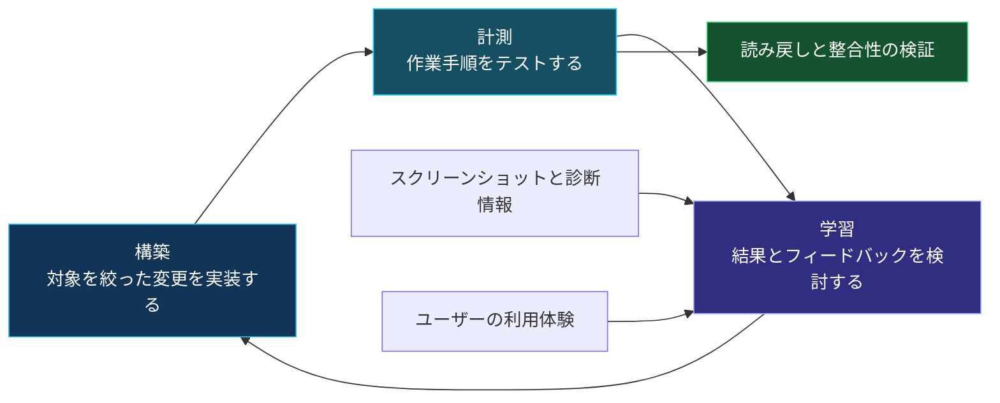
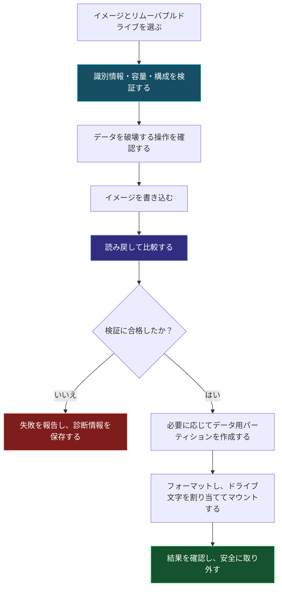

# Nexus Imaging Studio

**ブラウザー版 1.0 · Windows デスクトップ版 3.2.13**

**[ブラウザーで試す](https://rdunbar01.github.io/Nexus-Imaging-Studio/Nexus_Imaging_Studio_Browser_v1.html)** · [Windows 版をダウンロード](https://github.com/RDunbar01/Nexus-Imaging-Studio/tree/main/releases/3.2.13) · [現在の README](https://github.com/RDunbar01/Nexus-Imaging-Studio/blob/main/README.md)

## ブラウザーでできること

ローカルの非圧縮イメージを選ぶか、**Try synthetic image** で明示的に生成されたテストイメージを試します。MBR パーティションの範囲と重複、プライマリ GPT ヘッダーとテーブルの CRC・配置、ISO 9660 シグネチャを調べます。バックグラウンド worker で 4 MiB 単位の SHA-256 計算と参照ハッシュ比較を行い、検査 JSON、ログ、実行コマンドを含まない準備チェックリストを保存できます。ファイルはアップロードされません。Python や PyTorch は不要です。

単一 HTML に画面、アルゴリズム、worker を内蔵し、オンライン評価とダウンロード後のオフライン利用を簡単にしています。これによって Windows の raw ディスクへのアクセス権が得られるわけではありません。**ブラウザーでは物理ドライブへの書き込み、フォーマット、消去、バックアップ、修復、復旧はできません。** 容量は手入力であり、自動検出ではありません。GPT テーブルの検査上限は 4 MiB です。バックアップ GPT、ファイルシステム、ブートローダー、物理メディアは検証しません。シグネチャやハッシュの一致だけでは起動可能性や配布元の身元を証明できません。

## デスクトップ機能と技術的貢献

別の Windows アプリはイメージ書き込みと読み戻し、raw バックアップ、パーティション・ボリューム管理、および対応する読み取り専用イメージからの復旧処理を提供します。AEGIS は決定論的なエラー対応、対象ディスクの識別、保護ディスクのガード、範囲チェック、ログ、部分検証の明示を組み合わせます。ブラウザー版は、特権を必要とするデスクトップ処理をインストールせずに、読み取り専用の準備段階を試せるようにします。

ネイティブ版には **Tkinter/Tcl-Tk を含む 64 ビット CPython 3.12** を使用します。PyTorch は不要です。リリースディレクトリ全体を取得し、[インストール手順](https://github.com/RDunbar01/Nexus-Imaging-Studio/blob/main/releases/3.2.13/INSTALL.txt)に従ってください。ローカルの `--preview` は物理ディスクを列挙しません。物理書き込みはデータを永久に失わせる可能性があります。別の装置にバックアップし、対象を独立して確認してください。合成テストやブラウザーテストは Windows/UAC、物理メディア書き込み、実験的 exFAT バックエンドを認定するものではありません。ネイティブ 3.2.13 パッケージは変更していません。

## 利用条件とクレジット

Rich Dunbar / Nexus Emerging Technology。AI 支援によるコーディングを利用しています。Nexus が権利を保有する資料の個人利用と社内の商業的テスト・評価は許可されます。配布、変更、本番運用、およびその他の商業利用には明示的な書面同意が必要です。第三者ライセンスと既に付与された権利は変更されません。[許可と適用範囲](https://github.com/RDunbar01/Nexus-Imaging-Studio/blob/main/COMMERCIAL_EVALUATION_PERMISSION.md) · [ライセンス](https://github.com/RDunbar01/Nexus-Imaging-Studio/blob/main/LICENSE)。

[English](https://github.com/RDunbar01/Nexus-Imaging-Studio/wiki/NEXUS-Imaging-Studio-(English)) · [Français](https://github.com/RDunbar01/Nexus-Imaging-Studio/wiki/NEXUS-Imaging-Studio-(French)) · [日本語](https://github.com/RDunbar01/Nexus-Imaging-Studio/wiki/%23-NEXUS-Imaging-Studio-(Japanese)) · [한국어](https://github.com/RDunbar01/Nexus-Imaging-Studio/wiki/NEXUS-Imaging-Studio-(Korean))

---

## 以下は過去の文書です：現行リリースの手引きではありません

**以下の原文は、調査した旧リリース v3.2.4 に基づく過去の文書として保持されています。バージョン、インストール、実行環境、ライセンス、性能に関する記述は、3.2.13 についての説明ではありません。以前に付与されたライセンス上の権利、および上流プロジェクトのライセンス、クレジット、通知は引き続き保持されます。**

# NEXUS Imaging Studio
### 起動ドライブを作成し、書き込みを検証し、残りの容量も活用する。

> **Rich Dunbar が、AI を活用したコーディングと「構築・計測・学習」を繰り返す開発を通じて制作。**  
> NEXUS Imaging Studio は、Nexus OS の開発作業を支えるために作りました。起動可能なイメージを USB ドライブに書き込み、その内容を検証し、残りの容量も使えるようにするツールです。

**Windows デスクトップアプリケーション · Python + Tkinter · Nexus OS 開発ツール**

---

## 👋 このツールを作った理由

私が求める使いやすさ、操作の自由度、作業の流れを、ちょうどよい形で組み合わせた無料のオープンソースツールが見つからなかったため、自分で作ることにしました。

私の中心となるプロジェクトは Nexus OS です。オペレーティングシステムの開発では、起動メディアを用意し、ビルドをテストし、結果を集め、次の改訂版を準備する作業を繰り返します。

そこで、次のことができる実用的なツールを求めていました。

- Nexus OS のイメージと、書き込み先の USB ドライブを選ぶ
- 進捗と診断情報を分かりやすく表示しながら、イメージを書き込む
- 書き込んだデータを検証する
- 残りの領域に独立したデータ用パーティションを作成し、マウントする
- 別のテストに使いたいときに、ドライブを再利用できる状態に戻したり、構成し直したりする

既存のオープンソースのイメージ書き込みツールにも、有用な機能があります。私の動機は、自分の開発手順に合う実装を作り、必要な操作を一つのインターフェースにまとめることでした。

---

## 🔁 AI の支援で作り、実際の結果を基に改善する

コーディング、デバッグ、アプリケーションの修正には、AI の支援を活用しました。作業の方向を決め、結果をテストし、そこで分かったことを次の改善につなげたのは私自身です。

私の「構築・計測・学習」のプロセスは、コードを生成して画面が開くかを確認するだけではありません。実際の作業手順を繰り返し試し、スクリーンショットと診断情報を記録し、問題の原因を特定し、修正版をテストします。

**開発は反復的なプロセスです。実装、観察、修正を繰り返すことで、実際に動作する成果が生まれます。**

### 動作する MVP から、さらに役立つツールへ

実用最小限の製品（MVP）では、イメージ書き込みの中核となる作業の流れを確立しました。実際に使い、テストし、改善できるものができたのです。

その後の学びでは、次のような実用上の問いに注目しています。

- 目的のドライブを見分けやすいか
- データを破壊する可能性のある操作が、明確に説明されているか
- 進捗表示は、アプリケーションが実際に行っている処理を反映しているか
- 検証の失敗が正確に報告されるか
- ユーザーが診断情報を理解し、エクスポートできるか
- 変更によって、それまで動いていた機能が損なわれていないか

ディスクユーティリティにおける**「実用最小限」とは、機能を絞りつつ、不可欠な安全対策を備えること**です。データ保護を、後から追加してもしなくてもよい改善として扱うことではありません。

この学習の循環は、最初の動作するバージョンができた後も続きます。フィードバック、失敗、実際に見つかった使いにくさを基に、次の改訂を進めます。

---

## ✅ 私自身のテスト経験

> **私自身の利用では、NEXUS Imaging Studio で USB への書き込みを数百回行い、エラーなく完了しています。**

これは、私のテスト環境と、私が使ったメディアやイメージでの経験を報告したものです。独立した第三者が監査した信頼性調査ではなく、あらゆる USB コントローラー、イメージ、コンピューター、ストレージ機器での動作を保証するものでもありません。

次の重要な取り組みは、アプリケーションのバージョン、デバイスの識別情報、イメージのハッシュ値、検証結果、診断ログなど、再現可能な検証に必要な記録を蓄積し続けることです。

---

## 🧰 アプリケーションにまとめた機能

以下の機能は、確認した v3.2.4 のソースコードに実装されていました。ソースコードの確認によって分かるのは、実装が存在するということです。実機によるテストの代わりにはなりません。

| 機能 | 目的 |
|---|---|
| イメージの書き込み | 対応するイメージを、選択したリムーバブルドライブに書き込む |
| 読み戻し検証 | 書き込んだデータを元のイメージと比較する |
| 残りの領域へのデータ用パーティション作成 | イメージ書き込み後に、利用可能なボリュームを作成・フォーマット・マウントする |
| ドライブの再利用・リセット | メディアを再利用可能なストレージ構成に戻す |
| パーティション管理 | フォーマット、削除、拡張、ドライブ文字の割り当てを管理する |
| RAW イメージのバックアップ | SHA-256 ダイジェストと取得マニフェストを付けてイメージを作成する |
| Undelete Lab | 読み取り専用のイメージファイルを対象に、範囲を限定して復元を試みる |
| 論理上書き | ホストからアクセス可能な領域を上書きし、読み戻しによって検証する |
| 診断とエクスポート | 結果を調査するために必要な情報を保存する |
| インターフェースのカスタマイズ | 9 種類の表示テーマから選ぶ |

### プロジェクトのきっかけとなった作業の流れ

### USB ドライブの残りの容量を活用する

アプリケーションには、**「Create and mount a data partition from remaining space」（残りの領域からデータ用パーティションを作成してマウントする）**というオプションがあります。

対応するディスク構成では、バックアップ GPT を物理ドライブの末尾に移動し、利用可能な容量からデータ用パーティションを作成できます。既定のボリュームラベルは **NEXUS_DATA** です。

インターフェースでは、アプリケーションと Windows の制限の範囲で、exFAT、NTFS、FAT32 を選択できます。実装されている処理には、少なくとも 64 MiB の空き領域が必要です。また、コードで定められた 32 GiB のしきい値を超える場合は、FAT32 の代わりに exFAT を使用します。

これにより、起動メディアの準備と追加ストレージの設定を、一つの作業の流れにまとめています。

---

## 🛡️ 安全対策と検証

確認した実装には、次の仕組みが含まれています。

- 通常のデバイス選択を USB、SD、MMC メディアに限定し、起動ディスクとシステムディスクを除外する
- デバイスの識別情報、容量、バスの種類を再確認する
- 識別が曖昧な場合は、デバイスを自動的に再取得しない
- ホスト側のストレージ情報を更新する前に、厳密な読み戻し検証が完了するまでロックを保持する
- 読み戻しの不一致が解消しない場合は、失敗として扱う
- 診断ログと、上限を設けた回復処理の履歴を記録する
- 管理者権限が必要な操作では、Windows の権限昇格を行う

このアプリケーションの AEGIS 回復ロジックは、決定論的なチェックと障害処理を用いています。「AI を活用した開発」は、アプリケーションの作り方を表すものであり、言語モデルがディスク操作を自律的に制御するという意味ではありません。

### 使用時に理解しておくべき重要な制約

> **イメージの書き込み、フォーマット、パーティションの削除、上書きは、データを破壊する可能性があります。重要なデータをバックアップし、選択した物理ドライブが正しいことを確認してから進めてください。**

- 厳格な検証を伴う起動メディア作成ワークフローでは、対象ドライブの**論理セクターサイズが 512 バイト**である必要があります。
- 任意の ISO が、そのまま USB ドライブからの起動に適しているとは限りません。
- 起動の成否は、イメージ、ファームウェア、対象ハードウェアにも依存します。
- 論理上書きによって、コントローラーレベルでの完全消去や、再マッピングされたフラッシュメモリのセルのサニタイズが保証されるわけではありません。
- 削除ファイルの復元には対応範囲の制限があり、任意のファイルの復元を保証することはできません。
- 稼働中のデータをバックアップする場合、取得中に元データが変更されると、整合性が失われる可能性があります。
- インターフェース上の「strict forensic」という表示は、外部機関によるフォレンジック認証を意味しません。

---

## 🧩 実装と、このプロジェクトの貢献

NEXUS Imaging Studio は、**Python/Tkinter で実装した Windows デスクトップアプリケーション**です。確認したバージョンでは、Python の標準ライブラリモジュールと、Windows のディスク・ストレージ機能を使用しています。

私の貢献は、アプリケーションを実装し、次の操作を、繰り返し実行できる Nexus OS 開発のワークフローとして統合したことです。

1. イメージの準備と検証
2. 必要に応じた、メディアの残りの容量の活用
3. ドライブの再利用、バックアップ、パーティション管理のツール
4. 次のデバッグに役立つ診断情報
5. 実際のテストを通じて形作った、統一されたインターフェース

この貢献は、アプリケーションとワークフローに関するものです。既存のオペレーティングシステムのインターフェース、ストレージ形式、ハッシュ手法、オープンソースの言語・UI コンポーネントを基盤にしています。

このプロジェクトは、AI を活用したコーディングと、実機でのテスト、反復的な改善を組み合わせ、特定の技術的なニーズに応えるツールを作れることを示しています。

---

## 📚 開発アプローチと関連研究

以下の文献は、開発方法の裏付けとなるものです。NEXUS Imaging Studio のベンチマークを行ったものでも、ディスクへの書き込みの安全性を認証したものでもありません。

### 1. 反復的な拡張

**Basili, V. R., & Turner, A. J. (1975).**  
[Iterative Enhancement: A Practical Technique for Software Development](https://www.cs.umd.edu/users/basili/publications/journals/J04.pdf). *IEEE Transactions on Software Engineering, SE-1*(4), 390–396.

小さく動作する実装から始め、拡張、デバッグ、分析を繰り返す手法を説明しています。

**このプロジェクトとの関連：** 中核となる一連の作業を完結させたうえで、検証可能な小さな単位で拡張していく開発を支えます。

### 2. ユーザー中心の設計と実証的な計測

**Gould, J. D., & Lewis, C. (1985).**  
[Designing for Usability: Key Principles and What Designers Think](https://research.ibm.com/publications/designing-for-usability-key-principles-and-what-designers-think--1). *Communications of the ACM, 28*(3), 300–311.

初期段階からユーザーに注目すること、実証的に計測すること、反復的に設計することを重視しています。

**このプロジェクトとの関連：** ユーザーがどのようにドライブを選び、警告を理解し、進捗を読み取るかを観察することが、インターフェースの改善につながります。

### 3. 継続的な実験

**Fagerholm, F., Sánchez Guinea, A., Mäenpää, H., & Münch, J. (2017).**  
[The RIGHT Model for Continuous Experimentation](https://orbilu.uni.lu/handle/10993/33062). *Journal of Systems and Software, 123*, 292–305.

製品の段階的な改善、明示的な仮説、計測、証拠に基づく意思決定を結び付けています。

**このプロジェクトとの関連：** 各改訂で何を検証するか、どのような証拠に基づいて次の変更を決めるかを考えるうえで、有用な基盤になります。

### 4. MVP を通じた学習

**Khanna, D., Nguyen-Duc, A., & Wang, X. (2018).**  
[From MVPs to Pivots: A Hypothesis-Driven Journey of Two Software Startups](https://arxiv.org/abs/1808.05630). *ICSOB 2018*, 172–186.

二つのソフトウェア系スタートアップが、開発中に MVP と仮説をどのように活用したかを調べています。学習が不完全で、必ずしも直線的に進まないことも扱っています。

**このプロジェクトとの関連：** 動作する MVP は学ぶ機会を生み出します。その機会を有用な改善につなげるには、テストとフィードバックを続ける必要があります。

---

## 🙏 クレジットとライセンス

NEXUS Imaging Studio は、次の方々や技術による成果を利用しています。

- **Python および Python Software Foundation のコミュニティ**
- **Tcl/Tk および Tkinter の開発貢献者**
- **Microsoft Windows のストレージ API とシステムユーティリティ**。関連する PowerShell のストレージコマンドや DiskPart を含みます。

確認したソースコードでは標準ライブラリがインポートされており、外部の pip パッケージのインポートは見つかりませんでした。

確認した資料には、プロジェクト全体に適用されるライセンスは含まれていませんでした。利用や変更などの許可については、リポジトリの現在の LICENSE ファイルを確認してください。他の NEXUS プロジェクトのライセンスが、このプロジェクトにも適用されると考えてはいけません。

今後のバージョンで第三者のコードを追加する場合は、それに適用される通知事項とクレジットを保持する必要があります。

---

## 💬 次のビルドをより良くするために

問題の報告には、次の情報があると役立ちます。

- アプリケーションのバージョンと Windows のバージョン
- USB デバイスのモデル、容量、論理セクターサイズ
- 分かる場合は、イメージの識別情報とハッシュ値
- 実行した操作の詳細と再現手順
- 期待していた動作と実際の結果
- スクリーンショットと、エクスポートした関連診断情報

ログやスクリーンショットを共有する前に、個人情報などの非公開情報を取り除いてください。

**構築する。計測する。学ぶ。検証する。改善する。**

*Rich Dunbar · NEXUS Emerging Technology*