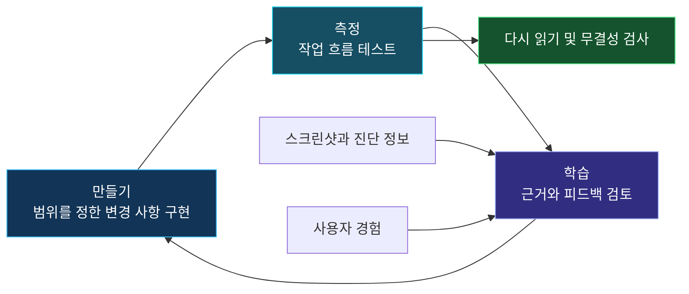
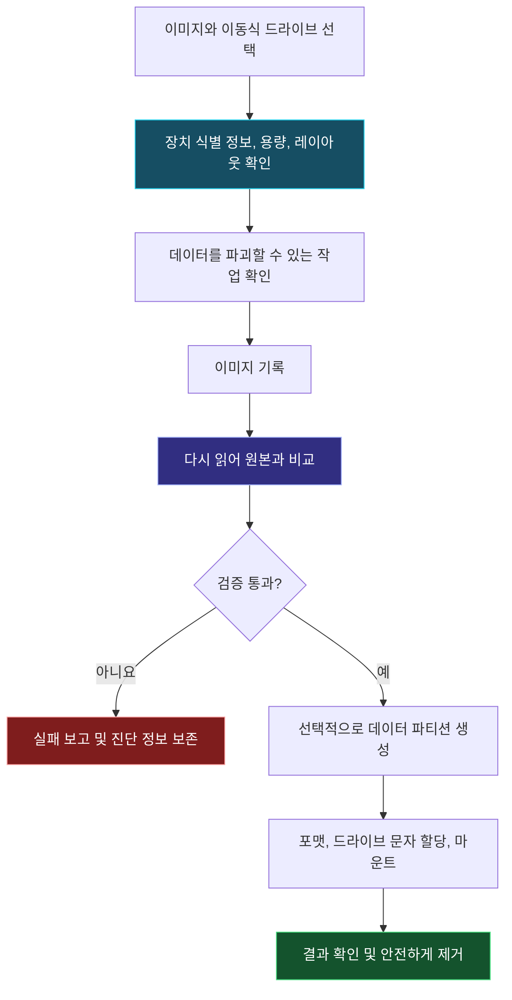

# Nexus Imaging Studio

**브라우저 버전 1.0 · Windows 데스크톱 버전 3.2.13**

**[브라우저에서 체험하기](https://rdunbar01.github.io/Nexus-Imaging-Studio/Nexus_Imaging_Studio_Browser_v1.html)** · [Windows 앱 다운로드](https://github.com/RDunbar01/Nexus-Imaging-Studio/tree/main/releases/3.2.13) · [현재 README](https://github.com/RDunbar01/Nexus-Imaging-Studio/blob/main/README.md)

## 브라우저 기능

로컬의 압축되지 않은 이미지를 선택하거나 **Try synthetic image**로 명시적으로 생성된 테스트 이미지를 사용하세요. MBR 파티션 범위와 겹침, 기본 GPT 헤더 및 테이블의 CRC와 배치, ISO 9660 서명을 확인합니다. 백그라운드 worker에서 4 MiB 단위로 SHA-256을 계산하고 입력한 참조 해시와 비교하며, 검사 JSON·로그·실행 명령이 아닌 준비 체크리스트를 저장할 수 있습니다. 파일은 업로드되지 않습니다. Python과 PyTorch는 필요하지 않습니다.

단일 HTML에 인터페이스, 알고리즘과 worker를 포함하여 온라인 평가와 다운로드 후 오프라인 사용을 간단하게 합니다. 이것이 Windows 원시 디스크 접근 권한을 제공하지는 않습니다. **브라우저에서는 물리 드라이브 플래싱, 포맷, 삭제, 백업, 수리 또는 복구를 수행할 수 없습니다.** 용량은 자동 감지가 아닌 수동 입력입니다. GPT 테이블 검사는 4 MiB로 제한됩니다. 백업 GPT, 파일 시스템, 부트로더와 물리 미디어는 검증하지 않습니다. 서명이나 해시 일치만으로 부팅 가능성 또는 배포자의 신원을 증명할 수 없습니다.

## 데스크톱 기능과 기술적 기여

별도 Windows 앱은 이미지 쓰기·읽기 검증, raw 백업, 파티션·볼륨 관리 및 지원되는 읽기 전용 이미지의 복구 작업을 제공합니다. AEGIS는 결정론적 오류 대응, 대상 디스크 식별, 보호 디스크 차단, 범위 검사, 로그 및 부분 검증의 명시적 보고를 결합합니다. 브라우저 버전은 권한이 필요한 데스크톱 작업 흐름을 설치하지 않고 읽기 전용 준비 단계를 평가할 수 있게 합니다.

네이티브 패키지에는 **Tkinter/Tcl-Tk를 포함한 64비트 CPython 3.12**를 사용하세요. PyTorch는 필요하지 않습니다. 릴리스 디렉터리 전체를 다운로드하고 [설치 지침](https://github.com/RDunbar01/Nexus-Imaging-Studio/blob/main/releases/3.2.13/INSTALL.txt)을 따르세요. 로컬 `--preview` 모드는 물리 디스크를 열거하지 않습니다. 물리 쓰기는 데이터를 영구적으로 파괴할 수 있으므로 다른 장치에 백업하고 대상을 독립적으로 확인하세요. 합성 및 브라우저 테스트는 Windows/UAC, 실제 미디어 쓰기 또는 실험적 exFAT 백엔드를 인증하지 않습니다. 네이티브 3.2.13 패키지는 변경하지 않았습니다.

## 이용 조건 및 제작

Rich Dunbar / Nexus Emerging Technology. AI 지원 코딩을 사용했습니다. Nexus 소유 자료의 개인적 이용과 내부 상업적 테스트·평가는 허용됩니다. 배포, 수정, 운영 환경 배포 및 그 밖의 상업적 이용에는 명시적인 서면 동의가 필요합니다. 제3자 라이선스와 이미 부여된 권리는 변경되지 않습니다. [허가 및 범위](https://github.com/RDunbar01/Nexus-Imaging-Studio/blob/main/COMMERCIAL_EVALUATION_PERMISSION.md) · [라이선스](https://github.com/RDunbar01/Nexus-Imaging-Studio/blob/main/LICENSE).

[English](https://github.com/RDunbar01/Nexus-Imaging-Studio/wiki/NEXUS-Imaging-Studio-(English)) · [Français](https://github.com/RDunbar01/Nexus-Imaging-Studio/wiki/NEXUS-Imaging-Studio-(French)) · [日本語](https://github.com/RDunbar01/Nexus-Imaging-Studio/wiki/%23-NEXUS-Imaging-Studio-(Japanese)) · [한국어](https://github.com/RDunbar01/Nexus-Imaging-Studio/wiki/NEXUS-Imaging-Studio-(Korean))

---

## 아래는 과거 문서입니다: 현재 릴리스 안내가 아닙니다

**아래 원문은 검토한 이전 릴리스 v3.2.4에 기반한 과거 문서로 보존됩니다. 버전, 설치, 실행 환경, 라이선스 및 성능에 관한 내용은 3.2.13에 대한 설명이 아닙니다. 이전에 부여된 라이선스상의 권리와 상위 프로젝트의 라이선스, 크레딧 및 고지는 계속 보존됩니다.**

# NEXUS Imaging Studio
### 부팅 드라이브를 만들고, 기록 결과를 검증하고, 남은 공간을 활용하세요.

> **Rich Dunbar가 AI 코딩 지원과 반복적인 만들기–측정–학습 과정을 통해 개발했습니다.**  
> 저는 Nexus OS 개발 작업에 활용하기 위해 NEXUS Imaging Studio를 만들었습니다. 부팅 가능한 이미지를 USB에 기록하고, 결과를 검증한 뒤, 드라이브의 남은 용량까지 유용하게 활용하는 것이 목표입니다.

**Windows 데스크톱 애플리케이션 · Python + Tkinter · Nexus OS 개발 도구**

---

## 👋 이 도구를 만든 이유

제가 원하던 단순함, 제어 수준, 작업 흐름을 모두 갖춘 무료 오픈 소스 도구를 찾지 못해 직접 만들기로 했습니다.

제 주요 프로젝트는 Nexus OS입니다. 운영체제를 개발하다 보면 부팅 미디어를 준비하고, 빌드를 테스트하고, 결과를 수집하고, 다음 수정 버전을 준비하는 과정을 반복하게 됩니다.

저는 다음 작업을 수행할 수 있는 실용적인 도구가 필요했습니다.

- Nexus OS 이미지와 기록할 USB 드라이브 선택
- 명확한 진행 상황과 진단 정보를 확인하며 이미지 기록
- 기록된 데이터 검증
- 남은 공간에 별도의 데이터 파티션을 만들고 마운트
- 다른 테스트에 필요할 때 드라이브를 초기화하거나 재구성

기존 오픈 소스 이미징 도구에도 유용한 기능이 많습니다. 저는 제 개발 과정에 맞는 도구를 구현하고, 필요한 작업을 하나의 인터페이스에 모으고자 했습니다.

---

## 🔁 AI의 도움으로 만들고, 근거를 바탕으로 개선하기

저는 코딩, 디버깅, 애플리케이션 수정에 AI의 도움을 받았습니다. 작업 방향은 제가 정하고, 결과를 직접 테스트한 뒤, 확인한 내용을 바탕으로 다음 개선 방향을 결정했습니다.

제가 따르는 만들기–측정–학습 과정은 코드를 생성하고 인터페이스가 열리는지 확인하는 데 그치지 않습니다. 실제 작업 흐름을 반복해서 실행하고, 스크린샷과 진단 정보를 수집하며, 문제의 원인을 찾아 수정한 버전을 다시 테스트하는 과정입니다.

**개발은 반복의 과정입니다. 구현하고, 관찰하고, 수정하는 주기를 거듭하면서 제대로 동작하는 결과에 도달합니다.**

### 동작하는 MVP에서 더 유용한 도구로

최소 기능 제품(MVP)은 핵심 이미징 작업 흐름을 구현한 출발점이었습니다. 실제로 사용하고, 테스트하고, 개선할 수 있는 대상을 마련한 것입니다.

이후의 학습은 다음과 같은 실용적인 질문에 초점을 맞춥니다.

- 작업할 드라이브를 쉽게 식별할 수 있는가?
- 데이터를 파괴할 수 있는 작업을 명확하게 설명하는가?
- 진행 상황 표시가 애플리케이션의 실제 작업 상태를 반영하는가?
- 검증 실패를 정확하게 보고하는가?
- 사용자가 진단 정보를 이해하고 내보낼 수 있는가?
- 변경 후에도 이전에 정상 동작하던 기능이 유지되는가?

디스크 유틸리티에서 **최소 기능이란 필수 안전장치를 갖춘, 범위가 명확한 기능 구성을 뜻합니다**. 데이터 보호를 나중에 선택적으로 추가해도 되는 개선 사항으로 취급한다는 뜻은 아닙니다.

첫 번째 동작 버전이 나온 뒤에도 같은 학습 주기는 계속됩니다. 피드백, 실패 사례, 실제 사용에서 드러난 불편함을 바탕으로 다음 버전을 개선합니다.

---

## ✅ 제가 직접 테스트한 경험

> **제가 직접 사용한 환경에서 NEXUS Imaging Studio는 수백 회의 USB 이미지 기록을 오류 없이 완료했습니다.**

이는 제 테스트 환경과 제가 사용한 미디어 및 이미지에 대한 경험 보고입니다. 독립적인 검증을 거친 신뢰성 연구가 아니며, 모든 USB 컨트롤러, 이미지, 컴퓨터, 저장 장치에서 같은 결과를 보장하지는 않습니다.

앞으로 가장 중요한 일은 재현 가능한 근거를 계속 기록하는 것입니다. 애플리케이션 버전, 장치 식별 정보, 이미지 해시, 검증 결과, 진단 로그가 여기에 해당합니다.

---

## 🧰 애플리케이션에 통합된 기능

아래 기능은 검토한 v3.2.4 소스 코드에서 확인했습니다. 소스 검토를 통해 구현이 존재함을 확인할 수 있지만, 실제 장치를 이용한 테스트를 대신할 수는 없습니다.

| 기능 | 용도 |
|---|---|
| 이미지 기록 | 지원되는 이미지를 선택한 이동식 드라이브에 기록 |
| 다시 읽기 검증 | 기록된 데이터를 다시 읽어 원본 이미지와 비교 |
| 남은 공간에 데이터 파티션 생성 | 이미지 기록 후 사용 가능한 볼륨을 만들고, 포맷하고, 마운트 |
| 드라이브 초기화 및 재사용 | 미디어를 다시 사용할 수 있는 저장 공간 구성으로 복원 |
| 파티션 관리 | 포맷, 삭제, 확장 및 드라이브 문자 할당 관리 |
| 원시 이미지 백업 | SHA-256 다이제스트와 획득 명세 파일을 포함한 이미지 생성 |
| Undelete Lab | 읽기 전용 이미지 파일에서 제한된 범위의 복구 시도 |
| 논리적 덮어쓰기 | 호스트가 주소를 지정할 수 있는 공간을 덮어쓰고 다시 읽어 검증 |
| 진단 및 내보내기 | 결과를 조사하는 데 필요한 정보 보존 |
| 인터페이스 사용자 지정 | 9가지 시각적 테마 중 선택 |

### 프로젝트의 출발점이 된 작업 흐름

### USB의 남은 공간 활용하기

애플리케이션에는 **“남은 공간에 데이터 파티션을 만들고 마운트”**하는 옵션이 있습니다.

지원되는 레이아웃에서는 백업 GPT를 물리 드라이브의 끝으로 옮기고, 사용 가능한 용량에 데이터 파티션을 만들 수 있습니다. 기본 볼륨 레이블은 **NEXUS_DATA**입니다.

인터페이스에서는 exFAT, NTFS, FAT32를 선택할 수 있으며, 애플리케이션과 Windows의 제약이 적용됩니다. 구현된 처리 경로에는 최소 64 MiB의 사용 가능한 공간이 필요하며, 코드에 지정된 32 GiB 기준을 초과하면 FAT32 대신 exFAT를 사용합니다.

이를 통해 부팅 미디어 준비와 추가 저장 공간 설정을 하나의 작업 흐름에서 수행할 수 있습니다.

---

## 🛡️ 안전장치와 검증

검토한 구현에는 다음 사항이 포함되어 있습니다.

- 일반적인 장치 선택을 USB, SD, MMC 미디어로 제한하고 부팅 디스크와 시스템 디스크를 제외
- 장치 식별 정보, 용량, 버스 유형 재확인
- 장치 식별이 모호할 때 자동으로 장치에 다시 접근하지 않도록 차단
- 호스트의 저장 장치 정보를 새로 고치기 전에, 기록 데이터를 정확히 다시 읽어 검증하는 동안 잠금 유지
- 다시 읽은 데이터의 불일치가 계속되면 실패로 처리
- 진단 로그와 제한된 범위의 복구 이력 기록
- 관리자 권한이 필요한 작업에서 Windows 권한 상승 사용

이 애플리케이션의 AEGIS 복구 로직은 결정론적 검사와 실패 처리를 사용합니다. AI 지원 개발은 애플리케이션을 만든 방식을 설명하는 말이며, 언어 모델이 디스크 작업을 자율적으로 제어한다는 뜻은 아닙니다.

### 중요한 사용 조건과 한계

> **이미지 기록, 포맷, 파티션 삭제, 덮어쓰기 작업은 데이터를 파괴할 수 있습니다. 중요한 데이터는 백업하고, 진행하기 전에 선택한 물리 드라이브를 반드시 확인하세요.**

- 엄격한 검증이 적용되는 부팅 작업 흐름에는 **논리 섹터 크기가 512바이트인** 대상 장치가 필요합니다.
- 모든 ISO가 USB 드라이브 부팅에 적합한 것은 아닙니다.
- 부팅 성공 여부는 이미지, 펌웨어, 대상 하드웨어에도 좌우됩니다.
- 논리적 덮어쓰기는 컨트롤러 수준의 완전 삭제나 재매핑된 플래시 셀의 데이터 제거를 인증하지 않습니다.
- 삭제된 파일의 복구 범위는 제한되어 있으며, 임의의 파일을 모두 복구할 수 있다고 보장하지 않습니다.
- 사용 중인 소스를 백업할 때 데이터 획득 도중 소스가 변경되면 백업의 일관성이 깨질 수 있습니다.
- 인터페이스의 “strict forensic” 표시는 외부 포렌식 인증을 의미하지 않습니다.

---

## 🧩 구현과 기여

NEXUS Imaging Studio는 **Python/Tkinter 기반 Windows 데스크톱 애플리케이션**입니다. 검토한 버전은 Python 표준 라이브러리 모듈과 Windows의 디스크 및 저장 장치 기능을 함께 사용합니다.

제가 기여한 부분은 애플리케이션 구현과, 반복 가능한 Nexus OS 개발 작업 흐름을 중심으로 다음 작업을 통합한 것입니다.

1. 이미지 준비 및 검증
2. 필요에 따른 미디어 잔여 용량 활용
3. 드라이브 초기화, 백업, 파티션 관리 도구
4. 다음 디버깅 주기에 도움이 되는 진단 정보
5. 실제 테스트를 통해 다듬은 통합 인터페이스

이 프로젝트의 기여는 애플리케이션과 작업 흐름에 있습니다. 기존 운영체제 인터페이스, 저장 형식, 해시 기법, 오픈 소스 언어 및 UI 구성 요소를 토대로 구현했습니다.

이 프로젝트는 AI 지원 코딩을 직접 수행하는 테스트와 반복적인 개선에 결합하여, 특정 엔지니어링 요구에 맞는 도구를 만들 수 있음을 보여 줍니다.

---

## 📚 개발 접근 방식과 관련 연구

다음 자료는 개발 방법론을 뒷받침합니다. NEXUS Imaging Studio의 성능을 평가하거나 디스크 기록의 안전성을 인증하는 자료는 아닙니다.

### 1. 반복적 향상

**Basili, V. R., & Turner, A. J. (1975).**  
[Iterative Enhancement: A Practical Technique for Software Development](https://www.cs.umd.edu/users/basili/publications/journals/J04.pdf). *IEEE Transactions on Software Engineering, SE-1*(4), 390–396.

작게 시작한 동작 가능한 구현을 반복해서 확장하고, 디버깅하고, 분석하는 방법을 설명합니다.

**관련성:** 완전한 핵심 작업 흐름을 먼저 구현한 뒤, 테스트 가능한 단위로 확장하는 접근을 뒷받침합니다.

### 2. 사용자 중심 설계와 실증적 측정

**Gould, J. D., & Lewis, C. (1985).**  
[Designing for Usability: Key Principles and What Designers Think](https://research.ibm.com/publications/designing-for-usability-key-principles-and-what-designers-think--1). *Communications of the ACM, 28*(3), 300–311.

초기부터 사용자에 주목하고, 실증적으로 측정하며, 반복적으로 설계할 것을 강조합니다.

**관련성:** 사용자가 드라이브를 선택하고, 경고를 이해하고, 진행 상황을 해석하는 방식을 관찰하면 인터페이스 개선 방향을 정할 수 있습니다.

### 3. 지속적 실험

**Fagerholm, F., Sánchez Guinea, A., Mäenpää, H., & Münch, J. (2017).**  
[The RIGHT Model for Continuous Experimentation](https://orbilu.uni.lu/handle/10993/33062). *Journal of Systems and Software, 123*, 292–305.

제품의 점진적 개선, 명시적인 가설, 측정, 근거에 기반한 의사결정을 연결합니다.

**관련성:** 각 수정 버전에서 무엇을 테스트하고, 어떤 근거를 바탕으로 다음 변경을 결정할지 정하는 데 유용한 토대를 제공합니다.

### 4. MVP를 통한 학습

**Khanna, D., Nguyen-Duc, A., & Wang, X. (2018).**  
[From MVPs to Pivots: A Hypothesis-Driven Journey of Two Software Startups](https://arxiv.org/abs/1808.05630). *ICSOB 2018*, 172–186.

두 소프트웨어 스타트업이 개발 과정에서 MVP와 가설을 어떻게 활용했는지 살펴보며, 학습이 불완전하고 비선형적으로 진행되는 특성도 다룹니다.

**관련성:** 동작하는 MVP는 학습 기회를 제공합니다. 그 기회를 유용한 개선으로 이어 가려면 지속적인 테스트와 피드백이 필요합니다.

---

## 🙏 기여에 대한 감사와 라이선스

NEXUS Imaging Studio는 다음 구성 요소와 커뮤니티의 작업을 바탕으로 합니다.

- **Python 및 Python Software Foundation 커뮤니티**
- **Tcl/Tk 및 Tkinter 기여자**
- 관련 PowerShell 저장 장치 명령과 DiskPart를 포함한 **Microsoft Windows 저장 장치 API 및 시스템 유틸리티**

검토한 소스는 표준 라이브러리를 가져와 사용하며, 외부 pip 패키지를 가져오는 코드는 확인되지 않았습니다.

검토한 자료에는 프로젝트 수준의 라이선스가 포함되어 있지 않았습니다. 허용되는 사용 범위는 저장소의 현재 LICENSE 파일을 확인하세요. 다른 NEXUS 프로젝트의 라이선스가 이 프로젝트에도 적용된다고 가정해서는 안 됩니다.

이후 버전에 추가되는 제3자 코드는 해당 고지 사항과 출처 표시를 유지해야 합니다.

---

## 💬 다음 빌드 개선에 참여하기

유용한 이슈 보고에는 다음 정보가 포함됩니다.

- 애플리케이션 버전과 Windows 버전
- USB 장치 모델, 용량, 논리 섹터 크기
- 가능한 경우 이미지 식별 정보와 해시
- 수행한 정확한 작업과 재현 절차
- 예상한 동작과 실제로 관찰한 결과
- 스크린샷과 관련 진단 정보 내보내기 파일

로그나 스크린샷을 공유하기 전에 개인 정보를 제거하세요.

**만들고. 측정하고. 배우고. 검증하고. 다듬으세요.**

*Rich Dunbar · NEXUS Emerging Technology*