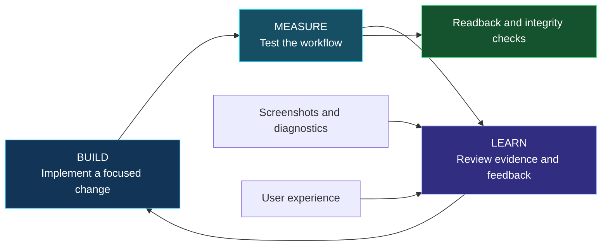
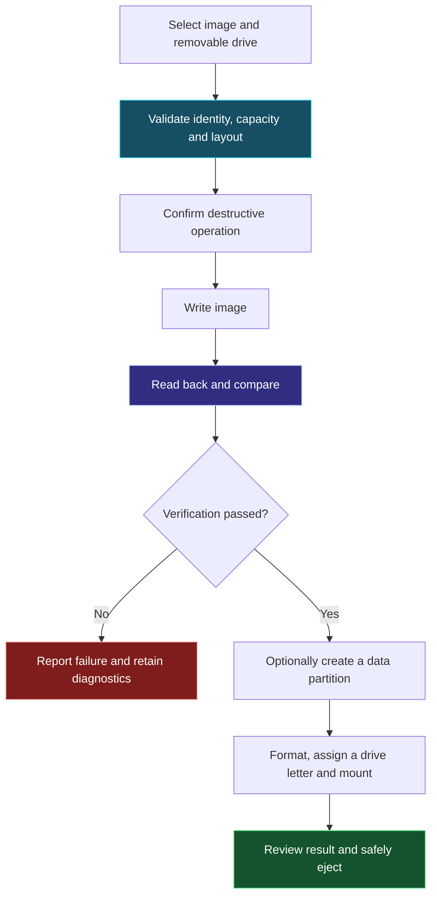

# Nexus Imaging Studio

**Browser edition 1.0 · Windows desktop 3.2.13**

**[Open the browser trial](https://rdunbar01.github.io/Nexus-Imaging-Studio/Nexus_Imaging_Studio_Browser_v1.html)** · [Desktop download](https://github.com/RDunbar01/Nexus-Imaging-Studio/tree/main/releases/3.2.13) · [Current README](https://github.com/RDunbar01/Nexus-Imaging-Studio/blob/main/README.md)

## Browser tools

Select a local, uncompressed image or use **Try synthetic image**. The browser inspects MBR partition bounds/overlap, primary GPT header and table CRCs/geometry, and ISO 9660 signatures. It calculates SHA-256 in a background worker using 4 MiB chunks, compares a supplied hash, and exports inspection JSON, session logs and a non-executable preparation checklist. Nothing is uploaded; no Python or PyTorch is required.

The single HTML embeds its interface, algorithms and worker code for quick online evaluation and offline use after download. This packaging does not provide access to Windows raw disks. **The browser cannot flash, format, erase, back up, repair or recover physical drives.** Capacity is manually entered, not detected. GPT tables are limited to 4 MiB; backup GPT, filesystems, bootloaders and physical media are not validated. A signature or matching checksum is not proof of bootability or publisher identity.

## Desktop tools and engineering contribution

The separate Windows application supports image writing/readback, raw backup, partition/volume management and supported read-only image recovery workflows. Its AEGIS layer uses deterministic error responses, target-identity checks, protected-disk guards, bounds checks, logs and explicit partial-verification reporting. The browser edition exposes a lower-risk, read-only preparation stage without installing the privileged desktop workflow.

Use **64-bit CPython 3.12 with Tkinter/Tcl-Tk** for the native package; there is no PyTorch dependency. Download the entire release directory and follow [installation instructions](https://github.com/RDunbar01/Nexus-Imaging-Studio/blob/main/releases/3.2.13/INSTALL.txt). The local `--preview` mode does not enumerate physical drives. Physical writes can permanently destroy data: back up to a different device and independently confirm the target. Windows/UAC/physical-media and experimental native exFAT behavior are not qualified by browser or synthetic tests. The native 3.2.13 package is unchanged.

## Use and credits

Rich Dunbar / Nexus Emerging Technology, with AI-assisted coding. Personal use and internal commercial testing/evaluation are permitted for Nexus-owned material. Distribution, modification, production deployment and other commercial use require express written consent. Third-party and previously granted rights remain unchanged. [Permission and scope](https://github.com/RDunbar01/Nexus-Imaging-Studio/blob/main/COMMERCIAL_EVALUATION_PERMISSION.md) · [License](https://github.com/RDunbar01/Nexus-Imaging-Studio/blob/main/LICENSE).

[English](https://github.com/RDunbar01/Nexus-Imaging-Studio/wiki/NEXUS-Imaging-Studio-(English)) · [Français](https://github.com/RDunbar01/Nexus-Imaging-Studio/wiki/NEXUS-Imaging-Studio-(French)) · [日本語](https://github.com/RDunbar01/Nexus-Imaging-Studio/wiki/%23-NEXUS-Imaging-Studio-(Japanese)) · [한국어](https://github.com/RDunbar01/Nexus-Imaging-Studio/wiki/NEXUS-Imaging-Studio-(Korean))

---

## Historical documentation below: not current release guidance

**The original text below is retained as historical documentation based on the inspected v3.2.4 release. Its version, installation, runtime, license and performance claims are not statements about 3.2.13. Previously granted license rights and upstream licenses, credits and notices remain preserved.**

# NEXUS Imaging Studio
### Build the boot drive. Verify the write. Use the remaining space.

> **Created by Rich Dunbar through AI-assisted coding and repeated build–measure–learn development.**  
> I built NEXUS Imaging Studio to support my Nexus OS workflow: write a bootable image to USB, verify it, and make the remaining drive capacity useful.

**Windows desktop application · Python + Tkinter · Nexus OS development tooling**

---

## 👋 Why I created it

I could not find a free, open-source tool that matched the particular combination of simplicity, control and workflow I wanted, so I decided to build my own.

My main project is Nexus OS. Developing an operating system means repeatedly preparing boot media, testing a build, collecting results and preparing the next revision.

I wanted a practical tool that would let me:

- Select a Nexus OS image and the intended USB drive.
- Flash the image with clear progress and diagnostics.
- Verify the written data.
- Create and mount a separate data partition in the remaining space.
- Reclaim or reconfigure the drive when I needed it for another test.

Existing open-source imaging tools have valuable capabilities. My motivation was to create an implementation suited to my own development process and bring the operations I needed into one interface.

---

## 🔁 Built with AI assistance, improved through evidence

I used AI to assist with coding, debugging and revising the application. I directed the workflow, tested the results and used the findings to guide the next iteration.

My build–measure–learn process involves more than generating code and checking whether the interface opens. It means repeatedly exercising the actual workflow, capturing screenshots and diagnostic information, identifying the cause of a problem and testing the revision.

**The development process is iterative. A working result emerges through repeated cycles of implementation, observation and correction.**

### From a working MVP to a more useful tool

The minimum viable product established the core imaging workflow. It provided something real to use, test and improve.

Subsequent learning focuses on practical questions:

- Is the intended drive easy to identify?
- Are destructive actions explained clearly?
- Does the progress display reflect what the application is doing?
- Is a verification failure reported accurately?
- Can the user understand and export the diagnostic information?
- Does a change preserve previously working behavior?

For a disk utility, **minimum viable means a focused feature set with essential safeguards**. It does not mean treating data protection as an optional later improvement.

The same learning loop continues after the first working version. Feedback, failures and observed friction guide the next revision.

---

## ✅ My testing experience

> **In my own use, NEXUS Imaging Studio has completed hundreds of USB flashes without error.**

This is my reported experience on my test bed and with the media and images I have used. It is not an independently audited reliability study or a guarantee for every USB controller, image, computer or storage device.

The strongest next step is to continue recording reproducible evidence: application versions, device identities, image hashes, verification outcomes and diagnostic logs.

---

## 🧰 What the application brings together

The capabilities below were confirmed in the reviewed v3.2.4 source. Source inspection establishes that the implementation is present; it does not replace physical-device testing.

| Capability | Purpose |
|---|---|
| Image flashing | Write a supported image to the selected removable drive |
| Readback verification | Compare written data against the source image |
| Remaining-space data partition | Create, format and mount a usable volume after imaging |
| Drive reclaim/reset | Return media to a reusable storage layout |
| Partition management | Format, delete, extend and manage drive-letter assignments |
| Raw-image backup | Create an image with a SHA-256 digest and acquisition manifest |
| Undelete Lab | Attempt bounded recovery from read-only image files |
| Logical overwrite | Overwrite host-addressable space and verify it by readback |
| Diagnostics and export | Preserve information needed to investigate a result |
| Interface customization | Choose among nine visual themes |

### The workflow that motivated the project

### Making the remaining USB space useful

The application includes an option to **“Create and mount a data partition from remaining space.”**

For supported layouts, it can relocate the backup GPT to the end of the physical drive and create a data partition from available capacity. The default volume label is **NEXUS_DATA**.

The interface offers exFAT, NTFS and FAT32, subject to application and Windows restrictions. The implemented path requires at least 64 MiB of available space and falls back from FAT32 to exFAT above its coded 32 GiB threshold.

This brings boot-media preparation and additional storage setup into one workflow.

---

## 🛡️ Safeguards and verification

The reviewed implementation includes:

- Normal device selection restricted to USB, SD and MMC media, with boot/system-disk exclusions.
- Rechecks of device identity, capacity and bus type.
- Refusal to automatically reacquire a device when identification is ambiguous.
- Locks held through exact readback verification before host storage refresh.
- Persistent readback mismatch treated as a failure.
- Diagnostic logging and bounded recovery history.
- Windows elevation for operations that require administrative access.

The AEGIS recovery logic in this application uses deterministic checks and failure handling. AI-assisted development describes how the application was created; it does not mean a language model autonomously controls the disk operations.

### Important operating boundaries

> **Flashing, formatting, partition deletion and overwrite operations can destroy data. Back up anything important and verify the selected physical drive before proceeding.**

- The strict validated boot workflow requires a target with **512-byte logical sectors**.
- An arbitrary ISO is not automatically suitable for booting from a USB drive.
- Boot success also depends on the image, firmware and target hardware.
- Logical overwrite does not certify controller-level purge or sanitization of remapped flash cells.
- Deleted-file recovery is bounded and cannot guarantee recovery of arbitrary files.
- A live backup may be inconsistent if its source changes during acquisition.
- A “strict forensic” interface label is not external forensic certification.

---

## 🧩 Implementation and contribution

NEXUS Imaging Studio is a **Python/Tkinter Windows desktop application**. The reviewed version uses Python standard-library modules together with Windows disk and storage facilities.

My contribution is the application implementation and the integration of these operations around a repeatable Nexus OS development workflow:

1. Image preparation and verification.
2. Optional use of remaining media capacity.
3. Reclaim, backup and partition-management tools.
4. Diagnostics that support the next debugging cycle.
5. A unified interface shaped through practical testing.

This is an application and workflow contribution. It builds on established operating-system interfaces, storage formats, hashing methods and open-source language/UI components.

The project demonstrates how AI-assisted coding can be combined with hands-on testing and iterative refinement to produce tooling for a specific engineering need.

---

## 📚 Development approach and related research

These sources support the development methodology. They do not benchmark NEXUS Imaging Studio or certify its disk-writing safety.

### 1. Iterative enhancement

**Basili, V. R., & Turner, A. J. (1975).**  
[Iterative Enhancement: A Practical Technique for Software Development](https://www.cs.umd.edu/users/basili/publications/journals/J04.pdf). *IEEE Transactions on Software Engineering, SE-1*(4), 390–396.

Describes beginning with a small working implementation and repeatedly extending, debugging and analyzing it.

**Relevance:** supports developing a complete core workflow, then expanding it through testable increments.

### 2. User-focused design and empirical measurement

**Gould, J. D., & Lewis, C. (1985).**  
[Designing for Usability: Key Principles and What Designers Think](https://research.ibm.com/publications/designing-for-usability-key-principles-and-what-designers-think--1). *Communications of the ACM, 28*(3), 300–311.

Emphasizes early attention to users, empirical measurement and iterative design.

**Relevance:** observing how users select drives, understand warnings and interpret progress can guide interface improvements.

### 3. Continuous experimentation

**Fagerholm, F., Sánchez Guinea, A., Mäenpää, H., & Münch, J. (2017).**  
[The RIGHT Model for Continuous Experimentation](https://orbilu.uni.lu/handle/10993/33062). *Journal of Systems and Software, 123*, 292–305.

Connects product increments, explicit hypotheses, measurement and evidence-informed decisions.

**Relevance:** provides a useful foundation for deciding what each revision should test and what evidence should determine the next change.

### 4. Learning through MVPs

**Khanna, D., Nguyen-Duc, A., & Wang, X. (2018).**  
[From MVPs to Pivots: A Hypothesis-Driven Journey of Two Software Startups](https://arxiv.org/abs/1808.05630). *ICSOB 2018*, 172–186.

Examines how two software startups used MVPs and hypotheses during development, including the incomplete and nonlinear nature of learning.

**Relevance:** a working MVP creates an opportunity to learn; continued testing and feedback are needed to turn that opportunity into useful improvements.

---

## 🙏 Attributions and licensing

NEXUS Imaging Studio relies on the work of:

- **Python and the Python Software Foundation community**
- **Tcl/Tk and Tkinter contributors**
- **Microsoft Windows storage APIs and system utilities**, including relevant PowerShell storage commands and DiskPart

The reviewed source uses standard-library imports; no external pip-package imports were identified.

A project-level license was not included in the reviewed materials. Consult the repository's current LICENSE file for permissions. A license from another NEXUS project should not be assumed to apply here.

Any additional third-party code incorporated into later versions should retain its applicable notices and attribution.

---

## 💬 Help improve the next build

A useful issue report includes:

- Application version and Windows version.
- USB device model, capacity and logical-sector size.
- Image identity and hash, where available.
- The exact operation and reproduction steps.
- Expected behavior and observed result.
- Screenshots and relevant exported diagnostics.

Remove private information before sharing logs or screenshots.

**Build. Measure. Learn. Verify. Refine.**

*Rich Dunbar · NEXUS Emerging Technology*