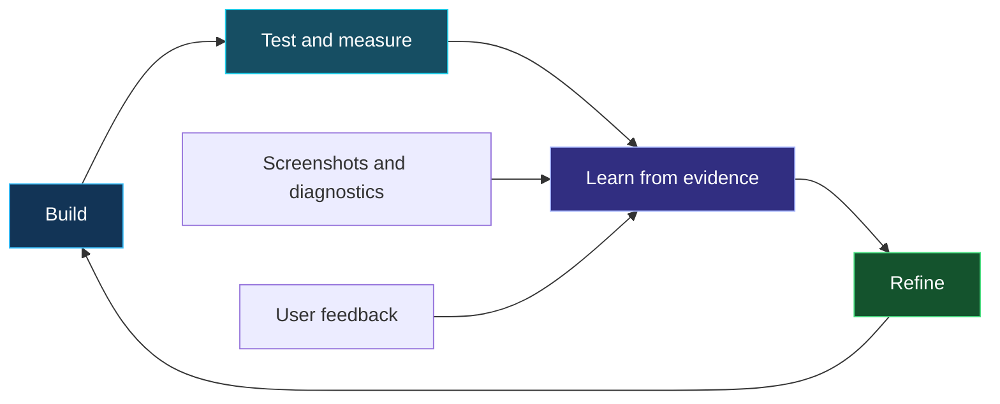

# Nexus Imaging Studio

**Browser edition 1.0 · Windows desktop 3.2.13**

**[Open the browser trial](https://rdunbar01.github.io/Nexus-Imaging-Studio/Nexus_Imaging_Studio_Browser_v1.html)** · [Desktop download](https://github.com/RDunbar01/Nexus-Imaging-Studio/tree/main/releases/3.2.13) · [Current README](https://github.com/RDunbar01/Nexus-Imaging-Studio/blob/main/README.md)

## Browser tools

Select a local, uncompressed image or use **Try synthetic image**. The browser inspects MBR partition bounds/overlap, primary GPT header and table CRCs/geometry, and ISO 9660 signatures. It calculates SHA-256 in a background worker using 4 MiB chunks, compares a supplied hash, and exports inspection JSON, session logs and a non-executable preparation checklist. Nothing is uploaded; no Python or PyTorch is required.

The single HTML embeds its interface, algorithms and worker code for quick online evaluation and offline use after download. This packaging does not provide access to Windows raw disks. **The browser cannot flash, format, erase, back up, repair or recover physical drives.** Capacity is manually entered, not detected. GPT tables are limited to 4 MiB; backup GPT, filesystems, bootloaders and physical media are not validated. A signature or matching checksum is not proof of bootability or publisher identity.

## Desktop tools and engineering contribution

The separate Windows application supports image writing/readback, raw backup, partition/volume management and supported read-only image recovery workflows. Its AEGIS layer uses deterministic error responses, target-identity checks, protected-disk guards, bounds checks, logs and explicit partial-verification reporting. The browser edition exposes a lower-risk, read-only preparation stage without installing the privileged desktop workflow.

Use **64-bit CPython 3.12 with Tkinter/Tcl-Tk** for the native package; there is no PyTorch dependency. Download the entire release directory and follow [installation instructions](https://github.com/RDunbar01/Nexus-Imaging-Studio/blob/main/releases/3.2.13/INSTALL.txt). The local `--preview` mode does not enumerate physical drives. Physical writes can permanently destroy data: back up to a different device and independently confirm the target. Windows/UAC/physical-media and experimental native exFAT behavior are not qualified by browser or synthetic tests. The native 3.2.13 package is unchanged.

## Use and credits

Rich Dunbar / Nexus Emerging Technology, with AI-assisted coding. Personal use and internal commercial testing/evaluation are permitted for Nexus-owned material. Distribution, modification, production deployment and other commercial use require express written consent. Third-party and previously granted rights remain unchanged. [Permission and scope](https://github.com/RDunbar01/Nexus-Imaging-Studio/blob/main/COMMERCIAL_EVALUATION_PERMISSION.md) · [License](https://github.com/RDunbar01/Nexus-Imaging-Studio/blob/main/LICENSE).

[English](https://github.com/RDunbar01/Nexus-Imaging-Studio/wiki/NEXUS-Imaging-Studio-(English)) · [Français](https://github.com/RDunbar01/Nexus-Imaging-Studio/wiki/NEXUS-Imaging-Studio-(French)) · [日本語](https://github.com/RDunbar01/Nexus-Imaging-Studio/wiki/%23-NEXUS-Imaging-Studio-(Japanese)) · [한국어](https://github.com/RDunbar01/Nexus-Imaging-Studio/wiki/NEXUS-Imaging-Studio-(Korean))

---

## Historical documentation below: not current release guidance

**The original text below is retained as historical documentation based on the inspected v3.2.4 release. Its version, installation, runtime, license and performance claims are not statements about 3.2.13. Previously granted license rights and upstream licenses, credits and notices remain preserved.**

# Welcome to NEXUS Imaging Studio
### Prepare your boot drive. Verify the result. Use the remaining space.

**Created by Rich Dunbar using AI-assisted coding and an iterative build–measure–learn process.**

NEXUS Imaging Studio is a Windows desktop utility for preparing and managing removable media. I developed it to support Nexus OS testing: flash a supported image, verify the written data and optionally turn the remaining USB capacity into a mounted data partition.

## 🌐 Available languages

The project documentation is available in:

- **English**
- **日本語 — Japanese**
- **한국어 — Korean**

Select your preferred language from the wiki’s page list. Each version covers the development story, features, safeguards, operating limitations and academic references.

日本語版では、開発の背景、機能、安全対策、利用上の制約、参考文献をご覧いただけます。

한국어 페이지에서는 개발 배경, 기능, 안전장치, 사용상의 제한 사항과 참고 문헌을 확인할 수 있습니다.

## 💡 Why I built it

I could not find a free, open-source tool that matched the particular workflow I wanted, so I built my own.

Developing Nexus OS involves repeatedly preparing boot media, testing a build, collecting results and preparing the next revision. I wanted a straightforward interface that brought imaging, verification, storage management and diagnostics together.

## 🧰 Core capabilities

| Tool | Purpose |
|---|---|
| Image flashing | Write a supported image to removable media |
| Readback verification | Compare written data against the source image |
| Remaining-space partition | Create, format and mount an additional data volume |
| Drive management | Reclaim, format and manage partitions |
| Raw-image backup | Save an image with a SHA-256 digest and acquisition manifest |
| Undelete Lab | Attempt bounded recovery from read-only image files |
| Diagnostics | Capture information for troubleshooting and improvement |

The reviewed v3.2.4 application is built with **Python and Tkinter for Windows**. It combines a custom interface with Python standard-library modules and Windows storage facilities.

## 🔁 Built through iteration

AI-assisted coding supports implementation and revision. Real tests, screenshots, diagnostic logs and user feedback guide the next change.

A working minimum viable product provides something concrete to test. Continued build–measure–learn cycles improve its reliability, clarity and usefulness.

## ✅ My testing experience

**In my own use, NEXUS Imaging Studio has completed hundreds of USB flashes without error.**

This is my reported experience with my test bed, images and media. It is not an independently audited reliability study or a guarantee for every device and configuration.

## ⚠️ Before you use it

**Flashing, formatting, partition deletion and overwrite operations can erase data. Back up important files and verify the selected physical drive before proceeding.**

- Boot compatibility depends on the image, firmware and target hardware.
- An arbitrary ISO is not automatically USB bootable.
- The strict validated boot workflow requires 512-byte logical sectors.
- Recovery cannot guarantee restoration of every deleted file.
- Logical overwrite does not certify controller-level sanitization of flash storage.

See the detailed documentation for supported workflows and limitations.

## 📚 What the wiki covers

- Why I created NEXUS Imaging Studio
- AI-assisted development and build–measure–learn iteration
- The importance of an MVP and continued user feedback
- Flashing, verification and additional data partitions
- Backup, recovery and storage management
- Safeguards, diagnostics and technical boundaries
- Academic references, dependencies and attribution

## 💬 Help improve the next version

When reporting an issue, include:

1. Application and Windows versions.
2. Device model, capacity and logical-sector size.
3. Image identity and hash, where available.
4. Steps to reproduce the issue.
5. Expected and observed behavior.
6. Relevant screenshots and diagnostic output.

Remove private information before sharing logs or screenshots.

---

**Build. Measure. Learn. Verify. Refine.**

*Rich Dunbar · NEXUS Emerging Technology*